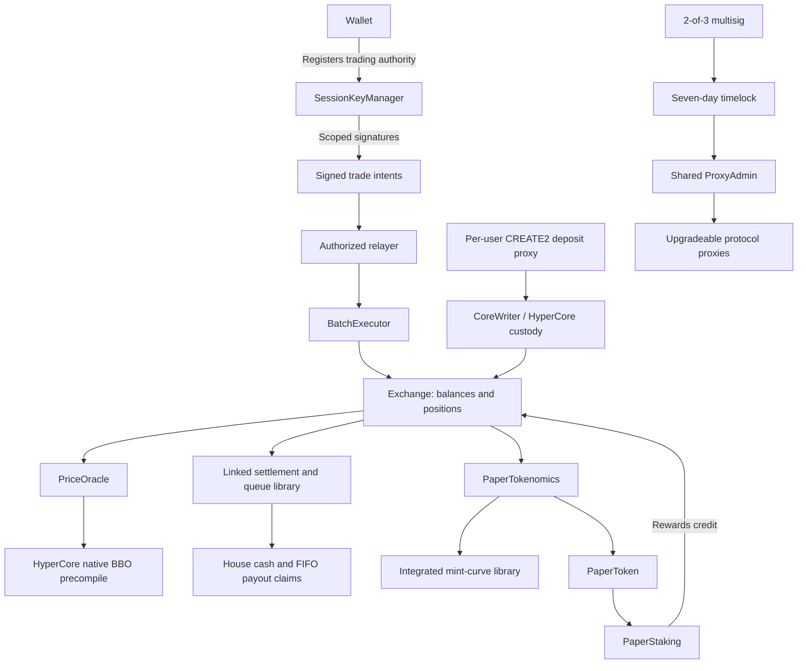

# Papertrade contracts: archive, logic and reverse engineering

[QA report — performance, 60 functionality tests and extreme fork scenarios](demo/docs/QA-REPORT-2026-10-16.md) includes raw results, failure recovery, the fixed historical-index limit and current demo limitations.

Shared multi-computer demo: [LAN setup and wallet guide](demo/docs/LAN.md). Run `npm run up:lan --prefix demo` from the repository root. Shared mode uses external wallet signatures and persistent fork transactions, with rehearsal rollback disabled. Incoming macOS/LAN access still needs verification; see the guide before the demo.

Local research copy of the deployed Papertrade protocol on HyperEVM (chain 999), captured on 15 October 2026. Start with [contract inventory](inspection/CONTRACTS.md), [interaction map](inspection/INTERACTIONS.md), and [token economics](inspection/TOKENOMICS.md).

**REA reverse engineering:** [reconstruction report](reverse-engineered/REPORT.md) contains REA evidence for 19 bytecode carriers, reconstructed Solidity, corrected batch ABI, exact mint/PnL rounding, recovered storage, and differential tests. The report separates tested reconstructions from incomplete paths.

**Our Robinhood implementation:** [standalone protocol folder](protocol/README.md) contains original Solidity contracts, local integration tests, Robinhood deployment configurations, and deployment/operations guides. It is separate from the archived Papertrade contracts and partial reconstructions.

**Interactive lab:** [Robinpaper demo](demo/README.md) runs a pinned Robinhood fork, the recovered math helpers inside a functional local exchange, ten actor wallets, and a Papertrade-inspired trading UI. Start with `npm run up --prefix demo`, then open http://127.0.0.1:4173.

## Reading order

1. [Contract inventory and implementation addresses](inspection/CONTRACTS.md).
2. [Trading, custody, signatures, keepers and governance](inspection/INTERACTIONS.md).
3. [PAPER emissions, house solvency, payout queue and staking](inspection/TOKENOMICS.md).
4. [Reconstructed contracts, evidence and verified behavior](reverse-engineered/REPORT.md).
5. [Remaining gaps and requirements for an EVM port](inspection/PORTING.md).

## Current captured logic structure

The architecture below describes the captured deployment and observed behavior on 15 October 2026. It is not a live monitor of future upgrades.



| Component | Responsibility and captured logic |
|---|---|
| Exchange | Locks isolated margin, opens/closes synthetic leveraged positions, maintains balances, house accounting and payout claims. Trades face the house rather than matching orders on Hyperliquid. |
| BatchExecutor | Accepts authorized relayers and `execute((address,bytes,bool,bytes32,bytes32)[])`. Allowed failures can cause subsequent calls in the same failure group to be skipped. |
| SessionKeyManager | Verifies scoped trading signatures and expiry. Nonces use an unordered bitmap; the public counter is a high-water mark. Withdrawals retain wallet authority. |
| PriceOracle | Reads native BBO and derives execution midpoint. BBO validity and execution-price validation are separate methods. |
| Settlement / queue | Applies deadband and asymmetric profit haircut with integer rounding. Cash harvesting pays oldest claims; opening against debt consumes the user's newest claims. |
| PaperTokenomics / mint library | Mints from eligible losses using a flat region followed by an integrated, decaying tail. Tail progress persists through surplus drains. |
| PaperToken | ERC-20-style balances with captured staking-only movement restrictions and separate privileged allowance authority. |
| PaperStaking | Accounts for staked PAPER and accumulated reward shares; signed stake/unstake/claim paths pass through authorized execution. |
| DepositProxyFactory / user proxy | Derives deterministic addresses and coordinates Core sweeps and later balance credit. The local archive contains one representative user proxy. |
| Governance | The multisig controls the timelock; observed delay is 604800 seconds. The timelock owns the shared proxy administrator and protocol ownership roles. |

The token, proxy, session registration and core arithmetic have differential execution evidence. Complete Exchange settlement routing, full staking/deposit reconstruction and native custody remain partially unresolved; each linked report records its coverage.

## What is here

- All 11 documented deployment addresses, their deployed runtime bytecode, and the eight Papertrade proxy implementations.
- Discovered proxy administration, linked Exchange libraries, Circle deposit wallet, USDC implementation, HyperCore writer, and one representative user deposit proxy.
- Original explorer-published Solidity sources, ABIs and compiler inputs for verified Circle/system dependencies. Original copyright and license headers are preserved.
- Protocol implementation bytecode, disassembly, selector maps, partial input signatures, and read-only state observations where original Solidity is unavailable.
- All 23 official documentation pages, 143 published frontend assets, and selected formatted frontend modules.
- Exact frontend EIP-712 message definitions and domain definitions, frontend deployment configuration, transaction/receipt samples, recent logs, and decoded interaction samples.
- A working Anvil fork with local tests against original protocol runtime code.

**The eight Papertrade implementations are unverified on HyperEVMScan and had no Sourcify source matches at capture time. Their original Solidity, full ABIs, storage layouts, compiler settings and deployment scripts are not available in this archive.** Locally generated `*InputSignatures.sol` files are partial calldata interfaces, not original contracts. Bytecode cannot uniquely recover original source. The linked libraries and representative deposit proxy are also archived as code rather than fabricated Solidity.

This is an inspection workspace, not a clean-room reimplementation or a deployment to another chain. The original backend/relayer source is not public in the assets collected. Its frontend interaction protocol is available for inspection.

## Run locally

Requirements: Node.js 22+, Python 3, curl, and Foundry (`anvil`, `cast`).

```sh
npm ci --ignore-scripts
npm test
npm run fork
```

In another terminal:

```sh
npm run test:fork
```

The local endpoint is `http://127.0.0.1:8545`, chain ID **31337**. The smoke suite refuses non-loopback URLs and any chain other than 31337, requires Anvil, and reverts its local changes afterward. It uses generated test wallets and local impersonation; it does not send transactions to HyperEVM.

The suite exercises mint authorization, launch transfer restrictions, approval, wallet-signed stake/unstake, session registration/revocation, leveraged position opening, replay rejection, profitable closing, and hard liquidation with PAPER emission. See [recorded results](local/smoke-results.json).

**Fixtures:** HyperCore is native chain behavior, not ordinary EVM code. The suite installs a clearly labeled static BBO fixture at the native read address. Test collateral is credited using an impersonated local staking authority. This tests Exchange accounting and signature paths, not actual deposits, bridging, live oracle security, liquidation keeper performance, payout queue recovery, or the production batch relayer. See [porting limitations](inspection/PORTING.md).

The fork lazily reads upstream state and therefore needs network access. The default public RPC ignores historical state tags: `snapshot.json` is a collection anchor, not a coherent historical state dump. See [recorded proof](inspection/rpc-history-check.json). For historical replay, supply a working archive provider:

```sh
PAPERTRADE_RPC_URL=https://your-archive-provider ARCHIVE_FORK_BLOCK=48602920 npm run fork
```

## Files to inspect

| Path | Purpose |
|---|---|
| `upstream/contracts/<name>/runtime.hex` | Exact captured deployed runtime |
| `upstream/contracts/<name>/implementation-runtime.hex` | Proxy implementation runtime |
| `upstream/contracts/<name>/metadata.json` | Address, proxy slots, publication status |
| `upstream/contracts/<name>/disassembly.txt` | EVM instructions |
| `upstream/contracts/<name>/selectors.txt` | Bytecode selector analysis and public signature candidates |
| `upstream/sources/` | Original published Solidity for verified dependencies |
| `upstream/frontend/assets/` | Published JavaScript/CSS; not original frontend source |
| `readable/frontend/` | Formatted copies of selected published modules |
| `upstream/docs/` | Official docs extracted as local HTML |
| `inspection/typed-data.json` | Exact signed-message schemas and domains |
| `inspection/selector-catalog.json` | Named candidates and unresolved selectors |
| `inspection/abi/` | Published frontend ABIs and separately labeled partial encoding candidates |
| `local/interfaces/` | Reconstructed input-only Solidity interfaces |
| `inspection/onchain-reads.json` | Raw responses, signature candidates and timestamps |
| `inspection/decoded-transactions.json` | Real transaction examples, including inferred batch wrappers |
| `inspection/sha256.json` | Checksums of upstream and formatted files |

Signature database results can collide. A matching selector alone does not establish parameter semantics, return types, mutability or authorization. `cast selectors` argument/mutability analysis is heuristic; several disabled functions appear `pure`. The catalog preserves uncertainty rather than promoting these to verified ABIs. The local tests supply stronger behavioral evidence for the specific tested paths.

## Collection and regeneration

```sh
npm run collect
npm run extract
python3 scripts/expand_dependencies.py
python3 scripts/capture_extras.py
npm run extract:sources
npm run inspect
npm run report
npm test
```

Collection fetches official pages, explorer publication data, Sourcify records and read-only RPC data. It does not connect a wallet. The current frontend entry is captured in `upstream/web/exchange-app.js`; if the site changes it, set `PAPERTRADE_FRONTEND_ENTRY` to a newly observed asset filename before collection. A collection refresh replaces observations and samples; use Git snapshots if you need to retain an earlier capture.

The original protocol reuse license could not be established from unpublished sources. This workspace does not assign a new license to upstream artifacts or treat source publication as permission to relicense them.

Presentation desk: [demo/docs/SHOWCASE.md](demo/docs/SHOWCASE.md) — one-click fork tour, live Binance desk, ten actors, product Q&A and restart guide.

Data backend: [Rust API + SQLite WAL + Redis](demo/backend/README.md), with [QA and local latency measurements](demo/backend-verification.json).
