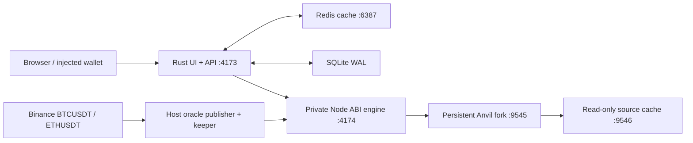

# Robinpaper — frontend, backend and persistent EVM fork

A functional trading demo on a Robinhood mainnet fork, using local chain **31337**, valueless **LABUSD/PART**, ten development actors, and reconstructed Papertrade settlement/mint math. Custody, authorization, queue and governance are our original v0.1 implementation, not recovered full Papertrade source.

## Source structure

| Directory | Role | Entry point |
| --- | --- | --- |
| [public/](public/README.md) | Static JavaScript frontend, charts, wallet signing, styles | `index.html`, `app.js`, `wallet.js` |
| [backend/](backend/README.md) | Rust Axum HTTP API, SSE, Redis cache and SQLite WAL index | `src/main.rs`, `src/store.rs`, `schema.sql` |
| [scripts/](scripts/) | Private Node contract engine, fork lifecycle, Binance publisher and keeper | `server.mjs`, `shared-session.mjs`, `start.mjs` |
| [contracts/](contracts/) | Local-only collateral, oracle and reconstructed exchange adapter | `LabContracts.sol` |
| [../protocol/](../protocol/README.md) | Core Solidity contracts and standalone deployment/operation guides | `src/Exchange.sol` |
| [../reverse-engineered/](../reverse-engineered/REPORT.md) | Recovered arithmetic helpers and behavioral evidence | SettlementMath and MintCurve |
| [test/](test/) and [qa/](qa/) | Integration tests and recorded extreme-test results | [QA report](docs/QA-REPORT-2026-10-16.md) |
| `.runtime/` (ignored) | Saved fork, deployment, SQLite, logs and private development-wallet exports | Never commit or serve publicly |

The frontend has no bundler or separate npm installation. Rust serves `public/` directly; Node dependencies are resolved from the locked `protocol/` package. Rust dependencies are locked in `backend/Cargo.lock`.



## Start the shared LAN demo

Requirements: **Node.js 22+**, Python 3 (QA tooling), a Rust toolchain supporting edition 2024, Foundry `anvil`, and `redis-server` in PATH. `redis-cli` is used by backend QA. No Binance API key is required.

From repository root:

```sh
npm ci --prefix protocol
npm run up:lan --prefix demo
# Startup is detached; wait for the UI/API to be ready before checking status.
npm run lan:status --prefix demo
npm run check --prefix demo
npm run lan:feed --prefix demo -- on
```

Startup compiles Solidity on first use, builds Rust with `--locked`, verifies the source chain/anchor, and starts the owned services. First launch creates a fork/deployment; later launches resume saved state. A fresh checkout needs an upstream RPC with historical state access; it does not contain this host's private runtime or exact saved demo ledger. `ROBINHOOD_FORK_URL` selects a provider; the source must be chain 4663. The saved anchor is checked on every resume. Never commit credential-bearing provider URLs.

Open **http://127.0.0.1:4173/#trade** on the host. Other computers use the LAN URL printed by `lan:status`, and wallet RPC **http://HOST_LAN_IP:4173/rpc** (chain 31337, currency ETH). Only Rust binds to all interfaces in shared mode. Anvil, Redis, the Node engine and source cache stay on loopback.

[LAN setup and firewall troubleshooting](docs/LAN.md) includes the outstanding second-computer reachability qualification. Keep the host awake, lid open and on the same Wi-Fi. An all-interface listener alone does not prove another computer can connect.

## Wallets and trading

Import one assigned development actor into an injected wallet, connect it to the UI, and sign transactions there. The actor selector only changes the account view in shared mode. It does not authorize spending as that actor. Host-only individual wallet files are created under `.runtime/participants/`; distribute the assigned file privately. Development keys are publicly known Anvil fixtures: never use them for real funds.

Deposit signs an ERC-20 approval followed by a deposit. Opens/closes are actual delayed onchain orders. The host feed publishes BTC/ETH prices and the keeper executes eligible signed orders or cancels expired ones. Normal participants can deposit, withdraw available cash, trade, stake/unstake/claim, inspect receipts and use their authorized ABI calls. Operator and governance actions still require the corresponding wallet authority.

[Actor roles](docs/WALLETS.md) · [Function coverage](docs/FUNCTION-COVERAGE.md) · [UI reconstruction](docs/UI-RECONSTRUCTION.md).

## Continuous prices, status and shutdown

```sh
npm run lan:feed --prefix demo -- on   # continuous Binance oracle + keeper
npm run lan:status --prefix demo       # feed/error/head/shared-mode status
npm run check --prefix demo            # read-only chain/custody/runtime/backend checks
npm run lan:feed --prefix demo -- off  # stop worker; preserve chain and transactions
npm run down --prefix demo            # graceful stop and save
npm run up --prefix demo              # resume; remembered LAN mode remains enabled
```

`up:lan` restarts owned services to configure LAN mode; do not repeatedly run it during participant activity. `up` leaves an already running service alone. Anvil saves periodically (15 seconds) and on graceful exit; abrupt termination can lose the most recent unsaved blocks. Preserve `.runtime/` to retain the ledger. Do not redeploy or replace compiled contracts against an active participant fork.

The continuous worker validates fresh positive eight-decimal Binance **spot** observations for BTCUSDT/ETHUSDT, then sends real transactions as Oracle actor 02. USDT is treated as LABUSD for this demo. Network/bad/stale responses produce a visible error with no invented-price fallback. The local oracle rejects quotes older than 30 seconds. This is one trusted offchain publisher, not an authenticated/decentralized production oracle.

## Contract and economic boundaries

`contracts/LabContracts.sol` calls the checked-in recovered SettlementMath and MintCurve helpers. [build-info.json](build-info.json) records source hashes; private deployment manifests record addresses/runtime hashes. The [standalone protocol](../protocol/README.md) documents deployment, operations and oracle integration separately.

- Leverage ceiling: **100x**; delayed orders require a later valid oracle observation and a price limit.
- Favorable PnL passes through a deadband and movement-based haircut. The recovered haircut does not take holding time as an input.
- Eligible realized losses mint restricted-transfer PART; stake it for funded collateral rewards. No token redemption or guaranteed loss compensation exists.
- Fees are conditional on queue/liquidity rules. Queue priority precedes new fee distributions.
- **5m LABUSD per UTC day** limits net trader-profit credits, including queue harvests. It is our added rule, separate from the **5m house surplus cap**. Principal and previously credited balances remain withdrawable.
- Unfunded profit claims may wait indefinitely. The cash invariant excludes queued liabilities; it is not a solvency guarantee.
- Seed liquidity is a non-redeemable contribution. Queued profits cannot fund new positions in v0.1.

See [accounting and tokenomics](../protocol/docs/LOGIC.md). The demo is an unaudited local prototype, not a deployment with real assets on Robinhood mainnet.

## Verification and isolated rehearsal

Use `npm run check --prefix demo` while participants are connected. It only reads chain/backend state and writes a local report.

**Do not run regression, benchmark, simulation or checkpointed showcase suites on the participant fork.** Those tools mutate or restore state and belong in a separate rehearsal environment. Shared mode disables server actor signing, key export, time travel, snapshots and rollback tours, including localhost requests.

In a separate checkout/runtime with local rehearsal mode, the existing suites include:

```sh
npm test --prefix demo
npm run test:backend --prefix demo
npm run test:showcase --prefix demo
npm run test:feed --prefix demo
cargo test --locked --manifest-path demo/backend/Cargo.toml
```

`simulate:binance` is a bounded checkpointed rehearsal, not the persistent shared feed. The old one-click [presenter tour](docs/SHOWCASE.md) also belongs to rehearsal mode. Use `lan:feed` for shared sessions.

[QA report](docs/QA-REPORT-2026-10-16.md) · [Raw extreme results](qa/results-2026-10-16.json) · [Verification history](docs/VERIFICATION.md). Recorded load results describe the tested machine and scenarios; they do not measure mainnet throughput or prove economic resistance.
