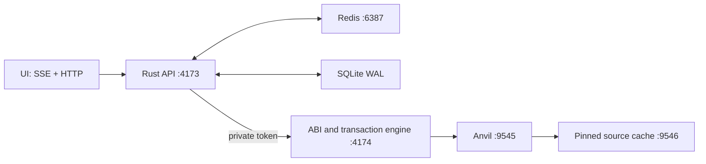

# Rust API, SQLite WAL and Redis

The public UI/API on **127.0.0.1:4173** is now an Axum/Tokio service. SQLite stores durable projections and indexed managed receipts/events; Redis caches verified state snapshots. The existing Node ABI/signature/transaction engine remains private on **127.0.0.1:4174**. Every write still executes on the saved Robinhood fork through real actors. Solidity contracts, deployed addresses and runtime bytecode are unchanged by this integration.

## Run

Requires Node.js 20.11+, Rust/Cargo, Foundry Anvil, and `redis-server` in PATH. QA uses `redis-cli` from the same Redis installation. Rust dependencies are pinned by Cargo.lock. From repository root:

```sh
npm ci --prefix protocol
npm run up --prefix demo
npm run check --prefix demo
```

Startup builds the Rust release binary with `cargo build --release --locked`, resumes Anvil state, starts owned Redis + private contract engine, then starts Rust. A warm Rust rebuild is incremental. Do not run a second Redis or another copy on these ports. `npm run down --prefix demo` stops the owned services; it waits for the showcase checkpoint to restore before stopping the fork. `REDIS_BIN` and `ANVIL_BIN` can select explicit binaries.

| Component | Loopback address / file | Responsibility |
| --- | --- | --- |
| Rust public API + static UI | 4173 | HTTP origin/host guards, shared state cache, writes proxy, SSE, diagnostics |
| Private Node engine | 4174 | ABI decoding, contract reads, real transactions, signatures, showcase, checkpoint/restore |
| Redis | 6387 | Namespaced verified snapshot cache; 10-second TTL; authenticated, no disk persistence |
| SQLite | `demo/.runtime/app.sqlite3` | WAL transaction for current state, active projections, managed transactions/events and chart observations |
| Anvil | 9545 | Source of truth: local chain 31337, Robinhood source 4663 |
| Source-fork cache | 9546 | Existing pinned upstream read cache; independent of the application cache |

## Data flow



A single shared worker checks lightweight engine/head metadata every 500ms. Contract snapshots are gathered once for a new engine revision/head, not once per browser. Simultaneous readers share the same refresh. Active position/order IDs are retained and updated alongside newly created IDs; settled historical IDs are not rescanned on every block. Initial reconstruction still has bounded lab limits of 1,000 positions and 2,000 orders.

The UI receives whole consistent snapshots through SSE. An HTTP check every 5 seconds provides recovery/freshness verification; writes force an immediate HTTP reload. Form drafts and selected actors remain local to the browser. A sync failure is visible and the client rechecks verified state before a new manual transaction. HTTP state responses expose the sampled block/hash and cache diagnostics. A cache hit is not a claim that a new block was just fetched for that individual reader.

## Cache correctness and rollback

State identity contains **engine boot ID + chain epoch + mutation revision + block hash**, rather than height alone. All EVM integers remain decimal strings through Rust JSON and SQL payloads. Actors select from the same public snapshot, preventing one actor's selection from contaminating another response.

- Before and after write forwarding, Rust invalidates its shared state. In-flight refreshes from an older mutation generation are discarded/retried.
- Node serializes snapshot collection with managed mutations and verifies the captured block hash is still canonical after collection. It shares repeated collections for the same identity.
- Snapshot/restore increments the epoch, invalidates live projections, and restores journal/price metadata. Same-height reverts cannot reuse the earlier cache entry.
- External fork rewinds are detected by head ancestry/hash. Managed journal receipts and hash-backed chart observations are reconciled against the restored chain; the local oracle cache is resynced from contract getters. Legacy imported scenario points without tx hashes are retained as historical observations, not used as authoritative execution prices.
- SQLite atomically replaces active projections. Epoch changes mark old indexed receipts noncanonical; confirmed receipts in the restored journal are reactivated. Reverted proof stays separate from canonical history.
- Redis and SQLite reuse requires an exact current engine identity. A persisted snapshot is never served as fresh state without checking the current engine/head. Restarting the engine changes its boot ID and rebuilds the current projection from the saved chain.
- Redis failure degrades to verified memory/engine + SQLite. The connection manager reconnects; the parent restarts its owned Redis if that process exits. DB projection failures are surfaced, not presented as a healthy index.
- Engine failure returns 503 with `stale:true` after bounded read timeouts. A short failure cooldown prevents concurrent readers from repeatedly blocking against a dead engine. SSE resumes when fresh snapshots are available; the UI also verifies state over HTTP.

Managed writes use estimated gas plus **20% + 10,000 gas**. QA found that repeating an oracle quote can estimate a cheaper unchanged timestamp slot at the latest block, while the mined block updates that slot; the previous exact estimate could run out of gas. Business-rule failures still revert normally.

## Database schema

See [schema.sql](schema.sql). `current_state` holds one verified snapshot and identity. `projection` contains current accounts, markets, active positions, pending orders and first-page claims. `transactions`/`events` hold the bounded managed executor journal with canonical status. `observations` holds the current chart window. Numeric protocol amounts are exact decimal JSON strings; chart prices are display observations.

This is a getter-based state projection plus the managed transaction journal, not a complete arbitrary-chain log backfiller. Direct external contract state changes are detected through the changed head; full external transaction history indexing is not claimed. The UI retains its first-50-claims and last-100-journal display limits. Captured showcase proofs are explicitly reverted evidence and are not inserted into canonical history after restore.

Useful local queries:

```sh
sqlite3 demo/.runtime/app.sqlite3 'PRAGMA journal_mode;'
sqlite3 demo/.runtime/app.sqlite3 'SELECT kind,count(*) FROM projection GROUP BY kind;'
sqlite3 demo/.runtime/app.sqlite3 'SELECT canonical,count(*) FROM transactions GROUP BY canonical;'
```

## API and diagnostics

- `GET /api/state?actor=6`: shared verified contract state, selected actor, block/hash/version/backend metadata.
- `GET /api/events`: SSE `state` events and keepalives.
- `GET /api/backend`: Rust/Redis/database health, cache counters and actual engine RPC method counters.
- `GET /api/index`: current projection counts and recent canonical managed receipts.
- Existing ABI, wallet export, receipt, action and showcase routes remain compatible.

Wallet exports are proxied only; never cached in Redis or SQL. The private engine requires a per-start random bearer header. Redis has its own per-start random password in ignored owner-only `redis.local.conf`; neither credential is printed or committed. Ports bind only to 127.0.0.1. The browser retains host/origin/request-header guards and CSP. This remains an intentionally unlocked ten-wallet local lab, not a public trading service or production authentication system.

## QA

```sh
cargo test --locked --manifest-path demo/backend/Cargo.toml
npm run test:backend --prefix demo
npm test --prefix demo
npm run test:showcase --prefix demo
npm run test:feed --prefix demo
npm test --prefix protocol
npm test
npm run check --prefix demo
```

Run mutation suites sequentially with no active manual user/showcase. Backend tests cover actual SQLite/Redis integration, 80 concurrent readers with no additional contract calls, per-actor isolation, write visibility, controlled rollback, same-height external rollback with history reconciliation, SSE real oracle transactions, Redis interruption/reconnection, repeated quote gas, and engine outage with stale-cache rejection. Every mutation test restores its checkpoint. The protocol suite uses a separate ephemeral Anvil.

SQLite WAL is the deliberate database for this single-machine fork. Horizontal production deployment would require additional database/indexer coordination, durable chain indexing, production wallet authorization and operational work; no PostgreSQL or distributed indexer is claimed here.

## Verified performance and handoff

See [backend-verification.json](../backend-verification.json) for actual results. Warm local state API p50 was 0.73 ms / p95 1.56 ms (n=100), against a pre-change full-read p50 of 258.18 ms (n=12). Eighty concurrent requests completed in 32.15 ms; the combined warm measurement made no additional contract eth_calls and one head check. Run `npm run bench:backend --prefix demo` to reproduce on this machine; it checkpoints/restores and refuses an active showcase. These figures do not measure chain confirmation or execution delay.

## Shared LAN mode

`npm run up:lan --prefix demo` binds only the Rust UI/API to all interfaces; Anvil, Redis, the source proxy and the signing engine stay on loopback. `/rpc` exposes an explicit JSON-RPC allowlist including signed lab-contract broadcasts. `/api/prepare` returns ABI-encoded unsigned wallet transactions or EIP-712 session data. Shared mode blocks `/api/action`, key export and checkpointed showcase mutations globally, including requests made from localhost. Wallet-extension origins receive RPC-only CORS support. Read-only RPC requests do not invalidate the state cache. External signed receipts are indexed from canonical blocks, while consistent block-tagged state snapshots continue driving UI/SSE.

The live worker publishes Binance quotes and executes orders in separate bounded serial operations, allowing snapshot reads between interval-mined transactions. Completed orders leave its active set. Shared snapshot reads allow up to five seconds for a mined operator transaction plus snapshot collection; engine metadata remains bounded to two seconds. No stale persisted snapshot is returned as fresh after a failure.

See [LAN.md](../docs/LAN.md) for current reachability, wallet setup, OS permission and validation limits.
