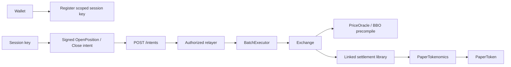

# Interaction map

Evidence: local official documentation, published frontend modules, recorded selector hashes, real calldata samples, and local fork test results. No production transactions were sent during this inspection.

## Trading and signatures

The Exchange typed-data domain in the published frontend is **name `String`, version `1`**, not `Papertrade`. Production uses chain ID 999 and the Exchange address as verifying contract. Staking uses **`PaperStaking`, version `1`** with its own verifying contract. The local tests use chain ID 31337 and verify actual onchain acceptance. Do not reuse production signatures across environments.

Exact field ordering is in `typed-data.json`. Relevant messages:

| Message | Signer | Main fields / destination |
|---|---|---|
| RegisterSessionKey | Wallet | user, key, expiry, feeAddress, nonce, deadline; SessionKeyManager |
| OpenPosition | Session key or accepted wallet authority | user, instrumentId, isLong, size, leverage, useDebt, nonce, deadline; Exchange |
| Close | Trading authority | user, positionIds[], nonce, deadline; Exchange |
| WithdrawToCore | Wallet | user, amount, nonce, deadline; Exchange |
| Stake / Unstake | Wallet | user, amount, nonce, deadline; PaperStaking |
| Claim / Distribute | Wallet / configured keeper authority | user, nonce, deadline; PaperStaking |
| CancelIntent | Wallet / frontend-supported authority | user, intentId, deadline; separate cancellation domain |

The `size` field on opens represents isolated margin, not BTC quantity. Internal dollar accounting uses 18 decimals; native USDC uses 6, with `collateralScale = 10^12`. The BTC/ETH price scaling recorded by the frontend is respectively 10 and 100. Always distinguish internal USD amounts, native token units, and price units.

Production opens/closes pass through the authorized executor. Direct public `openPosition`/`close`-style selectors may exist but are disabled. Local tests impersonate the executor to isolate Exchange behavior; this does not reproduce the relayer's scheduling policy.

`readable/frontend/app-*.js` shows action names `registerSessionKey`, `openPosition`, `closePositions`, `withdrawToCore`, `paperStake`, `paperUnstake`, and `paperClaim`, submission to `POST /intents`, pending-request handling and cancellation. Full HTTP route coverage is not established by `http-routes.json` because dynamic template routes are only partly indexed; the readable modules preserve them.

## Deposits and withdrawals

1. Factory computes a deterministic per-user CREATE2 address.
2. The frontend registers the address with the backend. Fund transfers arrive on HyperCore, or via the Circle deposit wallet / bridge routes.
3. Authorized deployer creates the user proxy. `SampleUserDepositProxy` is one actual deployed example; the archive is not an enumeration of all user accounts.
4. `requestSweep(user)` snapshots Core balances and triggers `sweepAllToExchange` through CoreWriter.
5. `finalizeSweep(user)` verifies the balance change and credits the internal Exchange balance.
6. Ambiguous/failed sweep cases may require owner reconciliation.
7. Withdrawals require the wallet's authority and move value back to Core, with optional onward routing handled separately.

An ERC-20 transfer straight to a user proxy is not the documented deposit route. Core movement is asynchronous and is not reproduced by an ordinary EVM fork. The verified `CoreDepositWallet` and `USDC` sources are included so their boundary can be inspected separately.

## Settlement and keepers

- Open: validate authority, nonce, deadline, market limits and balance; read BBO midpoint; lock margin; record position.
- Profitable close: return cash-funded surviving margin; apply deadband, impact and win fee; pay profit from available LP cash or append debt to FIFO queue.
- Losing close: deduct loss, route proceeds to LP or queue side bucket, and mint PAPER on the eligible basis.
- Hard liquidation: close the position under the separate full-margin-loss rule, mint PAPER, and apply the documented fee exceptions.
- `harvest(maxEntries)`: bounded FIFO payout processing; public maintenance path.
- `pushStakerFees()`: push eligible accumulated fees and LP surplus; distribution updates staking accumulator separately.
- Market keeper changes per-side exposure limits; pause guardian can block opens or permanently retire a market at a captured quote.

The local suite verifies opens, winning closes, replay rejection and hard liquidation under static price fixtures. Debt-funded trades, FIFO harvesting, emergency market retirement, live keeper ordering and full withdrawal/deposit flows are documented and archived but have not been behaviorally tested end-to-end here.

## Governance and upgrades

The Exchange, token and related implementation owners point to the timelock. The shared protocol ProxyAdmin also points to that timelock. The timelock owner is the 2-of-3 multisig and its observed minimum delay is 604800 seconds. This is observed state, not a guarantee that future owners/implementations remain the same.

The custom protocol proxies expose `upgradeToAndCall`, `implementation`, `changeAdmin` and `admin`; these are proxy methods, not implementation selectors. Proxy slot values are archived even when proxy getter access is restricted.

## Real transaction samples

`transaction-samples.json` contains raw transactions and receipts, including creation transactions and recent calls. `decoded-transactions.json` resolves known outer/inner signatures. Follow-up REA/trace research recovers the BatchExecutor input signature as `execute((address,bytes,bool,bytes32,bytes32)[])`, selector `0x251fb27d`. The fields are labeled target, calldata, allowFailure, failureGroup and itemId. Original field names are unknown; bool validation, group skipping and these semantics are corroborated by runtime traces. A failure group skips later matching calls after an allowed failure; it does not roll back earlier successes. See `reverse-engineered/auth/FINDINGS.md`.

Session nonces are an unordered bitmap (`nonce >> 8`, bit `nonce & 255`). The public `nonces(user)` getter acts as a high-water mark, not a requirement that each new request use the next sequential value. Reuse is rejected via the bitmap. See the concrete session reconstruction and differential registration trace.
