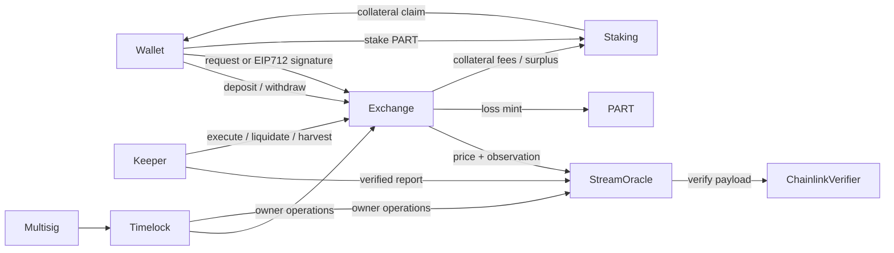

# Logic and accounting

## Relationships



Collateral/margin/cash/notional/fees use **raw 6 decimals**. Oracle prices and impact/mint parameters use **18 decimals**. PART uses 18 decimals. A $100 margin is `100000000`, and a $80,000 price is `80000000000000000000000`. Positions are isolated; no portfolio netting or cross-margin.

## Cash invariant

At all times supported collateral balance at exchange is at least:

`totalBalances + lockedMargin + houseCash + stakerFees + developerFees`

`lockedMargin` includes pending-open reservations. Queued profits are separately recorded **unfunded promises**, excluded from cash-backed balances and not spendable margin. Direct unsolicited ERC-20 transfers can make actual custody exceed accounted assets; they do not become house cash automatically. Keepers should alert on inequality rather than count the excess as user credit.

Deposit checks exact received amount. Tokens that rebase, charge withdrawal fees or can confiscate/freeze custody are unsupported or require additional risk controls. No core admin has arbitrary custody withdrawal.

## Order lifecycle

1. Wallet deposits collateral. It calls `request`, or signs the exact EIP-712 `Order` accepted by `requestBySig`. An unordered nonce bit is consumed at acceptance. Cancelling does not restore it.
2. Open acceptance moves margin from balance to locked reserve. Signature key margin budget is deducted cumulatively; cancellation does not restore it. Close acceptance marks one pending close against the existing position, with zero margin/leverage fields and at least 2 seconds holding time.
3. `eligibleAt = request block timestamp + market.delay`; deadline must fall within eligibleAt and eligibleAt + executionWindow. Delay/window each have hard bounds 2–60 sec. A keeper updates the oracle and anyone can execute before deadline using a report observation in that window. Cached precommit prices are rejected. Buy means long-open/short-close: price must be <= limit. Sell means short-open/long-close: price must be >= limit.
4. On open execution, per-side notional (`margin * leverage`) must fit the cap. Position snapshots impact/bust parameters and entry price. Pending opens prevent risk reconfiguration, as do live positions. Leverage hard ceiling is 100; examples use 20.
5. Close settles to cash plus optional queued profit. Wallet can cancel any pending order; anyone can cancel after expiry. Cancelling opens releases reserve; close cancellation leaves the position intact. Opens pause does not prevent closes, deposits, withdrawals or cancellations.

Execution is permissionless, not automatic. There is no first-report guarantee: within-window keeper choice, timestamp granularity and sequencer ordering remain economic risks. Latest-only oracle storage also means a newer report may make an older order ineligible; user cancels/resubmits. No promise of instant fills is made.

Retirement fixes the market permanently to a current healthy oracle price, disables opens and allows later closes/liquidations at the frozen value without a live oracle. It is irreversible and trusts guardian judgment. User close price limits still apply; cancel/resubmit if necessary. There is no arbitrary owner settlement price fallback during an oracle outage.

## Sessions

Domain: name `Robinhood Synthetic Protocol`, version `1`, actual chain ID, exchange address. Exact type:

```text
Order(address user,uint32 market,uint256 positionId,uint128 margin,uint32 leverage,bool isLong,uint256 priceLimit,uint256 nonce,uint64 deadline)
```

Wallet or registered signer can be EOA or ERC-1271. Session expires within 30 days; wallet sets a cumulative raw-collateral margin budget, revokes/replaces to increment version, and can invalidate nonce bitmap words. Revocation invalidates already accepted pending orders signed by that session. Session keys may open/close with the budget, but cannot withdraw, stake, change sessions, or impersonate a wallet. A zero margin budget still permits closes; this is an intentional permission. Keys are not per-market scoped; use minimal budgets and short lifetimes. Nonce invalidation prevents future acceptance, while accepted orders require explicit cancel.

## Settlement and emissions

Losing voluntary PnL is `min(margin, floor(margin * leverage * abs(exit-entry) / entry))`. No account can lose more than isolated margin. Liquidation can occur when adverse linear loss plus `margin * leverage * bustBufferBps / 10000 >= margin`; it consumes full margin. There is no liquidation reward, so operators must supply reliable liquidation keepers.

Winning paths subtract a price deadband `entry / 50000`, compute linear profit, then apply the decreasing scale defined precisely in `Economics.pnl`. The impact model takes move, base, rate, position and reference USD parameters. All floors are integer operations. Tiny moves with rounded-zero denominators produce zero adjusted profit. The sample parameters are not empirically calibrated.

When the queue is empty, voluntary losses carve 2% as fees; the rest enters house cash. While queued promises exist, the entire loss enters house cash. Liquidation emission basis is full loss even when a fee is carved. Voluntary-loss basis is loss minus actual fee. Fees split 50/50 between staking and developer, with any raw-unit odd remainder to developer.

Winning adjusted profit is reduced by 2%. Fee reserves accrue only if the queue is empty, house cash covers the gross profit, and the daily budget covers the full net profit; otherwise that 2% is a discount with no fee claim. Net profit is paid from available house cash when there are no older claims, and any remainder queued. With a queue, new profits queue in full. Margin principal returns immediately to the user's balance.

PART issuance is 100 tokens per loss-dollar while tracked LP progress remains below $2m. Above the threshold, the integrated tail uses a $120m decay scale and a persistent monotonic tail-progress ratchet. `trackedLpWad` is a signed economic tracker, not current house cash: net losses increase it; net promised profit plus actual fees decrease it; surplus distribution decreases it; seed donations do not change it. A falling tracker can re-enter the flat region even though tail progress never resets. There is no hard emission cap or claim that this curve prevents farming.

PART is minted only by exchange, cannot transfer wallet-to-wallet or on a DEX, and can move into/out of staking only when staking itself calls the token. Approvals do not grant arbitrary third-party transfers. Mint authorization is wired once.

### Global daily profit payout cap

`DAILY_PAYOUT_LIMIT = 5_000_000e6` is a fixed contract constant. `profitPaidByDay[block.timestamp / 86400]` counts **net trader profits credited to cash-backed exchange balances**, both direct closes and FIFO harvests. `_payProfit` is the common accounting path, bounding every credit by requested profit, house cash and the remaining daily allowance. Credited profits count immediately, even if the wallet withdraws later. There is no owner setter or per-user reset.

Once the budget is exhausted, closing still settles margin and records unpaid net profit; harvest leaves the queue head intact. A later UTC day provides a new allowance, but payment still requires cash and a keeper call. Existing queue priority always prevents direct new winners from bypassing older claims. Fees on a close that cannot fully fit the daily budget are treated as an unpaid discount, matching other deferred closes; existing reserved fees remain unchanged.

Excluded: returned margin, deposits, withdrawal of existing balances, developer fees, staking distributions/claims and surplus sweeps. Those are separately accounted flows, so this is not a global treasury-outflow cap. Staking payouts do not consume the trader budget. Amount is measured in 6-decimal collateral units assuming a $1 peg; no collateral/USD conversion exists.

Days reset at 00:00 UTC, with no rollover of unused allowance. This is a fixed calendar-day cap, **not a rolling 24-hour cap**: up to $10m could be credited around a midnight boundary across two days. It throttles liquidity release, not profit accrual, debt growth or potential losses. It does not guarantee solvency, prevent oracle exploitation, or reserve house assets against unrealized trader profits. The existing $5m house surplus cap is a separate policy.

`harvest(1..100)` spends house cash against oldest claims first, may partially fill the head, and credits cash-backed user balances. It charges no new fee. `pushFees` cannot run with queued promises; `sweepSurplus` additionally requires no positions or pending opens and house cash above cap. Surplus goes entirely to staking, not LP donors. Reserved earlier fees remain reserved when later queue debt appears.

Staking transfers PART and uses a 1e27 accumulator. New rewards are pre-funded in collateral. With no stakers, rewards wait until a subsequent notification with stakers present; they are not released merely by staking. Claims transfer collateral directly to the wallet. Integer dust can remain in reward reserve; no owner dust withdrawal exists. This v0.1 distribution is susceptible to timing participation around predictable fee pushes; assess whether delayed staking/snapshots are needed.

## Differences from the inspected Papertrade contracts

| Area | This implementation |
| --- | --- |
| Pricing and custody | Verified external streams and ERC-20 custody; no HyperCore |
| Queued profit collateral | Disabled; no debt-funded trade branch |
| Auth and relaying | Original EIP-712 budgeted sessions; permissionless execution, no recovered batch executor dependency |
| Staking claim | Transfers actual collateral to wallet |
| Configuration | Immutable deployments and timelocked administration; no proxies |
| Liquidity | Donations plus retained losses; no redeemable LP token |
| Token scheme | New PART contract and loss curve, not an assertion of original source equivalence |

The research archive contains evidence and uncertainty about Papertrade. Those unresolved branches are not silently imported into this protocol.
